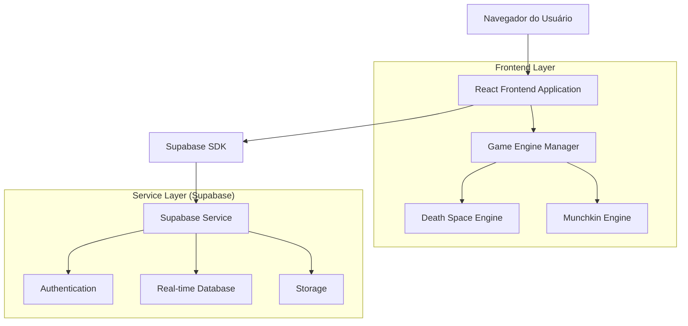
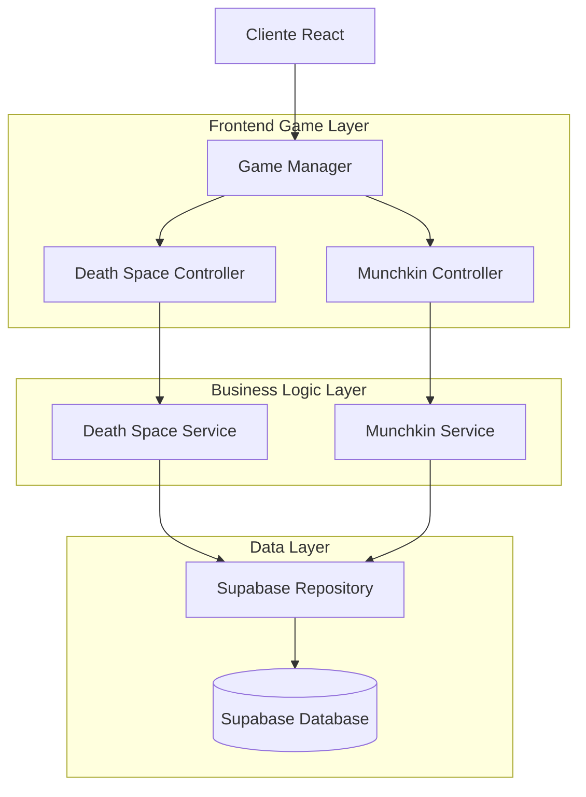
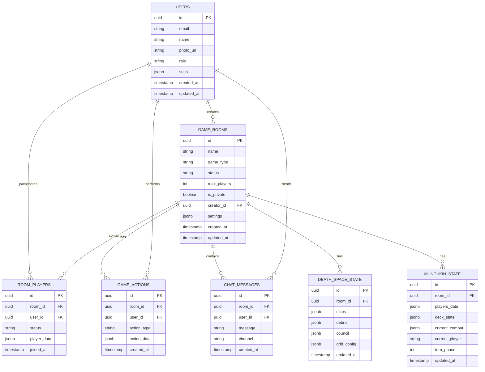

# Arquitetura Técnica - Plataforma Coruja Games

## 1. Arquitetura do Sistema



## 2. Descrição das Tecnologias

* **Frontend**: React@18 + TypeScript + Chakra UI + Vite

* **Backend**: Supabase Free Tier (PostgreSQL + Real-time + Auth)

* **Estado Global**: React Context API + Custom Hooks

* **Roteamento**: React Router DOM@7

* **Estilização**: Chakra UI + Emotion

* **Build Tool**: Vite

* **Deploy**: Vercel Free Tier (Frontend) + Supabase Free Tier (Backend)

### 2.1 Limitações da Versão Beta (Free Tier)

**Vercel Free Tier:**
* 100GB de bandwidth por mês
* 100 deployments por dia
* Domínio .vercel.app
* Sem analytics avançados

**Supabase Free Tier:**
* 500MB de storage
* 2GB de bandwidth por mês
* Até 50,000 usuários ativos mensais
* Pausa automática após 1 semana de inatividade
* 2 projetos máximo

## 3. Definições de Rotas

| Rota                    | Propósito                                         |
| ----------------------- | ------------------------------------------------- |
| /                       | Página inicial com seleção de jogos e dashboard   |
| /auth                   | Página de autenticação (login/registro)           |
| /lobby/:gameType        | Lobby específico do jogo (deathspace ou munchkin) |
| /game/:gameType/:roomId | Interface de jogo em tempo real                   |
| /profile                | Perfil do usuário com estatísticas e histórico    |
| /admin                  | Painel administrativo (apenas admins)             |
| /spectate/:roomId       | Modo espectador para assistir partidas            |

## 4. Definições de API

### 4.1 APIs Principais

**Gerenciamento de Salas**

```typescript
// Criar sala
POST /api/rooms
```

Request:

| Nome do Parâmetro | Tipo                       | Obrigatório | Descrição                         |
| ----------------- | -------------------------- | ----------- | --------------------------------- |
| name              | string                     | true        | Nome da sala                      |
| gameType          | 'deathspace' \| 'munchkin' | true        | Tipo do jogo                      |
| maxPlayers        | number                     | true        | Número máximo de jogadores        |
| isPrivate         | boolean                    | false       | Se a sala é privada               |
| settings          | GameSettings               | false       | Configurações específicas do jogo |

Response:

| Nome do Parâmetro | Tipo                 | Descrição               |
| ----------------- | -------------------- | ----------------------- |
| roomId            | string               | ID único da sala criada |
| status            | 'success' \| 'error' | Status da operação      |
| message           | string               | Mensagem de retorno     |

**Sistema de Autenticação**

```typescript
// Login via Supabase Auth
POST /auth/login
```

Request:

| Nome do Parâmetro | Tipo   | Obrigatório | Descrição        |
| ----------------- | ------ | ----------- | ---------------- |
| email             | string | true        | Email do usuário |
| password          | string | true        | Senha do usuário |

Response:

| Nome do Parâmetro | Tipo           | Descrição                    |
| ----------------- | -------------- | ---------------------------- |
| user              | User           | Dados do usuário autenticado |
| session           | Session        | Token de sessão              |
| error             | string \| null | Erro se houver               |

**Ações de Jogo**

```typescript
// Executar ação no jogo
POST /api/game-actions
```

Request:

| Nome do Parâmetro | Tipo       | Obrigatório | Descrição            |
| ----------------- | ---------- | ----------- | -------------------- |
| roomId            | string     | true        | ID da sala           |
| playerId          | string     | true        | ID do jogador        |
| action            | GameAction | true        | Ação a ser executada |
| gameType          | string     | true        | Tipo do jogo         |

Response:

| Nome do Parâmetro | Tipo           | Descrição                 |
| ----------------- | -------------- | ------------------------- |
| success           | boolean        | Se a ação foi executada   |
| gameState         | GameState      | Estado atualizado do jogo |
| error             | string \| null | Erro se houver            |

## 5. Arquitetura do Servidor



## 6. Modelo de Dados

### 6.1 Definição do Modelo de Dados



### 6.2 Linguagem de Definição de Dados (DDL)

**Tabela de Usuários**

```sql
-- Criar tabela de usuários
CREATE TABLE users (
    id UUID PRIMARY KEY DEFAULT gen_random_uuid(),
    email VARCHAR(255) UNIQUE NOT NULL,
    name VARCHAR(100) NOT NULL,
    photo_url TEXT,
    role VARCHAR(20) DEFAULT 'member' CHECK (role IN ('member', 'admin')),
    stats JSONB DEFAULT '{}',
    created_at TIMESTAMP WITH TIME ZONE DEFAULT NOW(),
    updated_at TIMESTAMP WITH TIME ZONE DEFAULT NOW()
);

-- Criar índices
CREATE INDEX idx_users_email ON users(email);
CREATE INDEX idx_users_role ON users(role);
```

**Tabela de Salas de Jogo**

```sql
-- Criar tabela de salas
CREATE TABLE game_rooms (
    id UUID PRIMARY KEY DEFAULT gen_random_uuid(),
    name VARCHAR(100) NOT NULL,
    game_type VARCHAR(20) NOT NULL CHECK (game_type IN ('deathspace', 'munchkin')),
    status VARCHAR(20) DEFAULT 'waiting' CHECK (status IN ('waiting', 'playing', 'finished')),
    max_players INTEGER NOT NULL DEFAULT 6,
    is_private BOOLEAN DEFAULT FALSE,
    creator_id UUID REFERENCES users(id) ON DELETE CASCADE,
    settings JSONB DEFAULT '{}',
    created_at TIMESTAMP WITH TIME ZONE DEFAULT NOW(),
    updated_at TIMESTAMP WITH TIME ZONE DEFAULT NOW()
);

-- Criar índices
CREATE INDEX idx_game_rooms_game_type ON game_rooms(game_type);
CREATE INDEX idx_game_rooms_status ON game_rooms(status);
CREATE INDEX idx_game_rooms_creator ON game_rooms(creator_id);
```

**Tabela de Jogadores em Salas**

```sql
-- Criar tabela de jogadores em salas
CREATE TABLE room_players (
    id UUID PRIMARY KEY DEFAULT gen_random_uuid(),
    room_id UUID REFERENCES game_rooms(id) ON DELETE CASCADE,
    user_id UUID REFERENCES users(id) ON DELETE CASCADE,
    status VARCHAR(20) DEFAULT 'active' CHECK (status IN ('active', 'eliminated', 'spectator')),
    player_data JSONB DEFAULT '{}',
    joined_at TIMESTAMP WITH TIME ZONE DEFAULT NOW(),
    UNIQUE(room_id, user_id)
);

-- Criar índices
CREATE INDEX idx_room_players_room ON room_players(room_id);
CREATE INDEX idx_room_players_user ON room_players(user_id);
```

**Tabela de Ações de Jogo**

```sql
-- Criar tabela de ações
CREATE TABLE game_actions (
    id UUID PRIMARY KEY DEFAULT gen_random_uuid(),
    room_id UUID REFERENCES game_rooms(id) ON DELETE CASCADE,
    user_id UUID REFERENCES users(id) ON DELETE CASCADE,
    action_type VARCHAR(50) NOT NULL,
    action_data JSONB NOT NULL,
    created_at TIMESTAMP WITH TIME ZONE DEFAULT NOW()
);

-- Criar índices
CREATE INDEX idx_game_actions_room ON game_actions(room_id);
CREATE INDEX idx_game_actions_user ON game_actions(user_id);
CREATE INDEX idx_game_actions_created ON game_actions(created_at DESC);
```

**Tabela de Mensagens de Chat**

```sql
-- Criar tabela de chat
CREATE TABLE chat_messages (
    id UUID PRIMARY KEY DEFAULT gen_random_uuid(),
    room_id UUID REFERENCES game_rooms(id) ON DELETE CASCADE,
    user_id UUID REFERENCES users(id) ON DELETE CASCADE,
    message TEXT NOT NULL,
    channel VARCHAR(20) DEFAULT 'general' CHECK (channel IN ('general', 'council', 'private')),
    created_at TIMESTAMP WITH TIME ZONE DEFAULT NOW()
);

-- Criar índices
CREATE INDEX idx_chat_messages_room ON chat_messages(room_id);
CREATE INDEX idx_chat_messages_channel ON chat_messages(room_id, channel);
CREATE INDEX idx_chat_messages_created ON chat_messages(created_at DESC);
```

**Estado do Death Space**

```sql
-- Criar tabela de estado do Death Space
CREATE TABLE death_space_state (
    id UUID PRIMARY KEY DEFAULT gen_random_uuid(),
    room_id UUID UNIQUE REFERENCES game_rooms(id) ON DELETE CASCADE,
    ships JSONB NOT NULL DEFAULT '[]',
    debris JSONB NOT NULL DEFAULT '[]',
    council JSONB NOT NULL DEFAULT '{"memberIds": [], "votes": []}',
    grid_config JSONB NOT NULL DEFAULT '{"width": 20, "height": 20}',
    updated_at TIMESTAMP WITH TIME ZONE DEFAULT NOW()
);

-- Criar índice
CREATE INDEX idx_death_space_room ON death_space_state(room_id);
```

**Estado do Munchkin**

```sql
-- Criar tabela de estado do Munchkin
CREATE TABLE munchkin_state (
    id UUID PRIMARY KEY DEFAULT gen_random_uuid(),
    room_id UUID UNIQUE REFERENCES game_rooms(id) ON DELETE CASCADE,
    players_data JSONB NOT NULL DEFAULT '{}',
    deck_state JSONB NOT NULL DEFAULT '{"doorDeck": [], "treasureDeck": [], "discardPiles": {}}',
    current_combat JSONB DEFAULT NULL,
    current_player UUID REFERENCES users(id),
    turn_phase INTEGER DEFAULT 1 CHECK (turn_phase BETWEEN 1 AND 4),
    updated_at TIMESTAMP WITH TIME ZONE DEFAULT NOW()
);

-- Criar índices
CREATE INDEX idx_munchkin_room ON munchkin_state(room_id);
CREATE INDEX idx_munchkin_current_player ON munchkin_state(current_player);
```

**Permissões Supabase**

```sql
-- Permissões básicas para usuários autenticados
GRANT SELECT ON users TO authenticated;
GRANT ALL PRIVILEGES ON game_rooms TO authenticated;
GRANT ALL PRIVILEGES ON room_players TO authenticated;
GRANT ALL PRIVILEGES ON game_actions TO authenticated;
GRANT ALL PRIVILEGES ON chat_messages TO authenticated;
GRANT ALL PRIVILEGES ON death_space_state TO authenticated;
GRANT ALL PRIVILEGES ON munchkin_state TO authenticated;

-- Permissões de leitura para usuários anônimos (espectadores)
GRANT SELECT ON game_rooms TO anon;
GRANT SELECT ON room_players TO anon;
GRANT SELECT ON chat_messages TO anon;
```

### 6.3 Monitoramento e Alertas (Versão Beta)

**Métricas Essenciais:**
```typescript
interface BetaMetrics {
  storageUsed: number; // MB usado de 500MB
  bandwidthUsed: number; // GB usado de 2GB/mês
  activeUsers: number; // Usuários online atual
  dailyActiveUsers: number; // DAU
  errorRate: number; // Taxa de erros
  responseTime: number; // Tempo médio de resposta
}
```

**Sistema de Alertas:**
- Storage > 80% (400MB): Alerta amarelo
- Storage > 90% (450MB): Alerta vermelho
- Bandwidth > 80% mensal: Notificação admin
- Usuários simultâneos > 25: Monitoramento intensivo
- Taxa de erro > 5%: Investigação imediata

**Dashboard de Monitoramento:**
```typescript
interface AdminDashboard {
  resourceUsage: BetaMetrics;
  activeRooms: GameRoom[];
  systemHealth: 'healthy' | 'warning' | 'critical';
  alerts: Alert[];
  recommendations: string[];
}
```

## 7. Estrutura de Componentes React

### 7.1 Hierarquia de Componentes

```
App
├── Router
│   ├── HomePage
│   │   ├── GameSelector
│   │   ├── ActiveRooms
│   │   └── UserDashboard
│   ├── AuthPage
│   ├── GameLobby
│   │   ├── RoomCreator
│   │   ├── RoomList
│   │   └── PreGameChat
│   ├── GamePage
│   │   ├── DeathSpaceGame
│   │   │   ├── GameBoard
│   │   │   ├── ShipControls
│   │   │   └── CouncilPanel
│   │   ├── MunchkinGame
│   │   │   ├── PlayerHand
│   │   │   ├── CombatArea
│   │   │   └── PlayerStatus
│   │   └── GameChat
│   ├── ProfilePage
│   └── AdminPage
└── Providers
    ├── AuthProvider
    ├── GameProvider
    └── SupabaseProvider
```

### 7.2 Tipos TypeScript Principais

```typescript
// Tipos base da plataforma
export type GameType = 'deathspace' | 'munchkin';

export interface PlatformUser {
  id: string;
  email: string;
  name: string;
  photoURL?: string;
  role: 'member' | 'admin';
  stats: UserStats;
  createdAt: Date;
}

export interface GameRoom {
  id: string;
  name: string;
  gameType: GameType;
  status: 'waiting' | 'playing' | 'finished';
  maxPlayers: number;
  isPrivate: boolean;
  creatorId: string;
  settings: GameSettings;
  players: RoomPlayer[];
  createdAt: Date;
}

export interface RoomPlayer {
  id: string;
  roomId: string;
  userId: string;
  status: 'active' | 'eliminated' | 'spectator';
  playerData: any;
  joinedAt: Date;
}

// Tipos específicos do Munchkin
export interface MunchkinPlayer {
  id: string;
  name: string;
  level: number;
  class?: string;
  race?: string;
  hand: Card[];
  equipment: Equipment[];
  bonuses: number;
}

export interface Card {
  id: string;
  name: string;
  type: 'door' | 'treasure';
  subtype: 'monster' | 'class' | 'race' | 'curse' | 'equipment' | 'item';
  level?: number;
  bonus?: number;
  description: string;
  imageUrl?: string;
}

export interface Combat {
  player: MunchkinPlayer;
  monster: Card;
  helpers: MunchkinPlayer[];
  interferors: MunchkinPlayer[];
  bonusCards: Card[];
  totalPlayerStrength: number;
  totalMonsterStrength: number;
}
```

