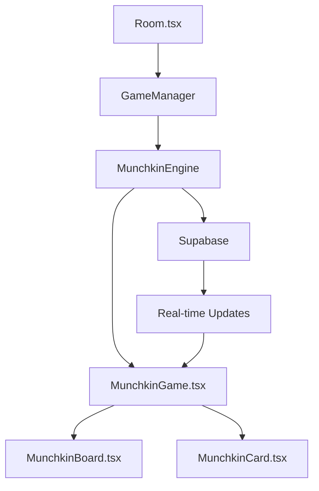

# Revisão Técnica do Jogo Munchkin

## 1. Arquitetura Atual

### 1.1 Estrutura de Arquivos
```
src/
├── engines/
│   ├── base/
│   │   └── GameEngine.ts          # Engine base abstrato
│   └── munchkin/
│       ├── MunchkinEngine.ts      # Engine específico do Munchkin
│       └── types/
│           └── munchkin.ts        # Tipos e interfaces
├── components/
│   └── games/
│       └── munchkin/
│           ├── MunchkinGame.tsx   # Componente principal
│           ├── MunchkinBoard.tsx  # Tabuleiro do jogo
│           └── MunchkinCard.tsx   # Componente de carta
├── services/
│   ├── GameManager.ts             # Gerenciador de jogos
│   └── supabase.ts               # Cliente Supabase
└── pages/
    └── Room.tsx                   # Página da sala de jogo
```

### 1.2 Fluxo de Dados


## 2. Análise do Problema "Jogador não encontrado"

### 2.1 Pontos de Investigação

#### GameManager.ts
- **Método**: `initializeGame()`
- **Possível problema**: Validação de jogadores antes da inicialização
- **Verificar**: Se os jogadores estão sendo corretamente recuperados do Supabase

#### MunchkinEngine.ts
- **Método**: `startGame()`
- **Possível problema**: Validação de `minPlayers` e estado dos jogadores
- **Verificar**: Se `this.players` está populado corretamente

#### Room.tsx
- **Componente**: Botão "Iniciar Partida"
- **Possível problema**: Estado dos jogadores não sincronizado
- **Verificar**: Se `room.players` contém dados válidos

### 2.2 Cenários de Erro Identificados

1. **Jogadores não carregados do Supabase**
   ```typescript
   // Possível causa em GameManager.ts
   const players = await this.getPlayersFromRoom(roomId);
   if (!players || players.length === 0) {
     throw new Error("Jogador não encontrado");
   }
   ```

2. **Engine não inicializado corretamente**
   ```typescript
   // Possível causa em MunchkinEngine.ts
   startGame(): void {
     if (this.players.length < this.minPlayers) {
       throw new Error("Jogadores insuficientes");
     }
   }
   ```

3. **Estado de sincronização perdido**
   ```typescript
   // Possível causa em Room.tsx
   const handleStartGame = () => {
     if (!room?.players?.length) {
       setError("Jogador não encontrado");
       return;
     }
   }
   ```

## 3. Checklist Técnico de Implementação

### 3.1 Tipos e Interfaces

#### MunchkinAction
```typescript
interface MunchkinAction extends GameAction {
  id: string;
  roomId: string;
  userId: string;
  actionType: MunchkinActionType;
  actionData: any;
  timestamp: number;
  type: MunchkinActionType;  // Propriedade específica do Munchkin
  data?: any;               // Dados específicos da ação
}
```

#### Card
```typescript
interface Card {
  id: string;
  name: string;
  type: 'door' | 'treasure';
  subtype?: string;
  description: string;
  effects?: CardEffect[];
  requirements?: Requirement[];
  rewards?: {              // Adicionado recentemente
    levels?: number;
    treasures?: number;
  };
}
```

### 3.2 Validações Críticas

#### Inicialização do Jogo
- [ ] Verificar se `minPlayers` está definido (padrão: 2)
- [ ] Validar se todos os jogadores têm `userId` válido
- [ ] Confirmar se o baralho foi inicializado
- [ ] Verificar se o estado inicial foi criado corretamente

#### Sistema de Turnos
- [ ] Validar `currentPlayerIndex`
- [ ] Verificar se `gamePhase` está definido
- [ ] Confirmar se `turnPhase` está correto

#### Sistema de Cartas
- [ ] Verificar se `doorDeck` e `treasureDeck` foram criados
- [ ] Validar distribuição inicial (4 cartas de porta, 4 de tesouro)
- [ ] Confirmar se `handLimit` está definido (padrão: 5)

### 3.3 Métodos Críticos para Revisão

#### MunchkinEngine.ts
```typescript
// Métodos que precisam de validação
- initializeGame()
- startGame()
- getPlayerState()
- validateAction()
- executeAction()
- validateKickDoor()
- executeKickDoor()
- handleCombatVictory()
- checkWinCondition()
```

#### GameManager.ts
```typescript
// Métodos que precisam de validação
- createGame()
- joinGame()
- startGame()
- getGameState()
- executeAction()
```

## 4. Plano de Debugging

### 4.1 Logs de Debug

#### Adicionar logs em pontos críticos:
```typescript
// Em GameManager.ts
console.log('🎮 Iniciando jogo:', { roomId, players: players.length });

// Em MunchkinEngine.ts
console.log('🃏 Estado do jogo:', {
  players: this.players.length,
  currentPlayer: this.gameState.currentPlayerIndex,
  gamePhase: this.gameState.gamePhase
});

// Em Room.tsx
console.log('🏠 Estado da sala:', {
  roomId: room?.id,
  playersCount: room?.players?.length,
  gameState: room?.game_state
});
```

### 4.2 Testes de Integração

#### Cenário 1: Criar e Iniciar Jogo
```typescript
// Teste manual
1. Criar sala
2. Adicionar 2+ jogadores
3. Clicar "Iniciar Partida"
4. Verificar se o jogo inicia sem erros
```

#### Cenário 2: Validação de Estado
```typescript
// Verificar no console do navegador
1. Estado da sala antes de iniciar
2. Estado do engine após inicialização
3. Estado do jogo após start
```

## 5. Correções Prioritárias

### 5.1 Correção Imediata (Crítica)

1. **Validação de Jogadores em startGame()**
   ```typescript
   // Em MunchkinEngine.ts
   startGame(): void {
     console.log('🚀 Iniciando jogo Munchkin:', {
       players: this.players.length,
       minPlayers: this.minPlayers
     });
     
     if (!this.players || this.players.length === 0) {
       throw new Error('Nenhum jogador encontrado na sala');
     }
     
     if (this.players.length < this.minPlayers) {
       throw new Error(`Mínimo de ${this.minPlayers} jogadores necessário`);
     }
     
     // Resto da implementação...
   }
   ```

2. **Verificação de Estado em Room.tsx**
   ```typescript
   // Em Room.tsx
   const handleStartGame = async () => {
     console.log('🎯 Tentando iniciar jogo:', {
       roomId: room?.id,
       players: room?.players?.length
     });
     
     if (!room?.players || room.players.length < 2) {
       setError('Pelo menos 2 jogadores são necessários');
       return;
     }
     
     try {
       await gameManager.startGame(room.id);
     } catch (error) {
       console.error('❌ Erro ao iniciar jogo:', error);
       setError(error.message);
     }
   };
   ```

### 5.2 Melhorias de Médio Prazo

1. **Sistema de Validação Robusto**
   - Implementar validações em cascata
   - Adicionar retry automático para falhas de rede
   - Melhorar mensagens de erro para o usuário

2. **Monitoramento de Estado**
   - Implementar logs estruturados
   - Adicionar métricas de performance
   - Criar dashboard de debugging

## 6. Testes Automatizados

### 6.1 Testes Unitários
```typescript
// MunchkinEngine.test.ts
describe('MunchkinEngine', () => {
  test('deve iniciar jogo com jogadores válidos', () => {
    const engine = new MunchkinEngine();
    engine.addPlayer(mockPlayer1);
    engine.addPlayer(mockPlayer2);
    
    expect(() => engine.startGame()).not.toThrow();
  });
  
  test('deve falhar com jogadores insuficientes', () => {
    const engine = new MunchkinEngine();
    engine.addPlayer(mockPlayer1);
    
    expect(() => engine.startGame()).toThrow('Mínimo de 2 jogadores');
  });
});
```

### 6.2 Testes de Integração
```typescript
// GameManager.test.ts
describe('GameManager Integration', () => {
  test('deve criar e iniciar jogo Munchkin', async () => {
    const gameManager = new GameManager();
    const roomId = await gameManager.createGame('munchkin');
    
    await gameManager.joinGame(roomId, 'player1');
    await gameManager.joinGame(roomId, 'player2');
    
    const result = await gameManager.startGame(roomId);
    expect(result.success).toBe(true);
  });
});
```

## 7. Monitoramento e Observabilidade

### 7.1 Métricas Importantes
- Taxa de sucesso na inicialização de jogos
- Tempo médio para iniciar uma partida
- Número de erros por tipo
- Latência das ações do jogo

### 7.2 Alertas
- Taxa de erro > 5% na inicialização
- Tempo de resposta > 3 segundos
- Falhas de sincronização com Supabase

---

**Próximo passo**: Executar o debugging sistemático seguindo este plano técnico.