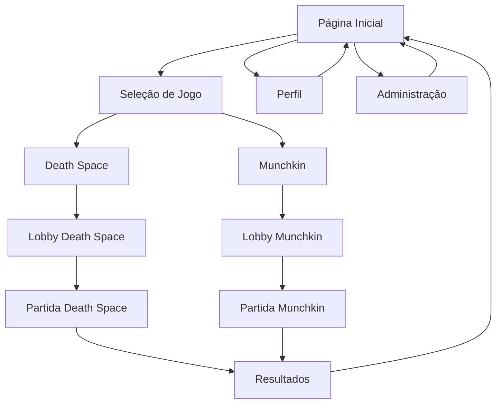

# Plataforma Coruja Games - Documento de Requisitos do Produto

## 1. Visão Geral do Produto

A Plataforma Coruja Games é uma plataforma web de jogos multiplayer **em versão beta** para o grupo Coruja, oferecendo uma experiência centralizada onde os membros podem acessar e jogar diferentes board games digitais. A plataforma inicialmente suportará dois jogos: Death Space (já existente) e um novo jogo baseado no Munchkin.

O objetivo é criar um hub de entretenimento digital que fortaleça a comunidade do grupo Coruja através de jogos estratégicos e interativos, validando o conceito para futuras expansões.

### 1.1 Limitações da Versão Beta
- **Usuários simultâneos**: Máximo 20-30 jogadores online
- **Storage**: 500MB total (otimização de assets necessária)
- **Bandwidth**: 2GB/mês (monitoramento de uso)
- **Domínio**: .vercel.app (gratuito)
- **Backup**: Manual via dashboard
- **Suporte**: Comunidade do grupo Coruja

## 2. Funcionalidades Principais

### 2.1 Papéis de Usuário

| Papel         | Método de Registro            | Permissões Principais                                    |
| ------------- | ----------------------------- | -------------------------------------------------------- |
| Membro Coruja | Autenticação via Google/Email | Pode criar salas, participar de jogos, chat              |
| Administrador | Convite especial              | Gerenciar usuários, moderar salas, adicionar novos jogos |

### 2.2 Módulos de Funcionalidade

Nossa plataforma de jogos consiste nas seguintes páginas principais:

1. **Página Inicial**: seletor de jogos, salas ativas, estatísticas do usuário
2. **Lobby do Jogo**: criação/entrada em salas, configurações de partida, chat pré-jogo
3. **Tela de Jogo**: interface específica do jogo selecionado, chat em tempo real, controles de ação
4. **Perfil do Usuário**: histórico de partidas, estatísticas, configurações pessoais
5. **Administração**: gerenciamento de usuários, moderação, configurações da plataforma

### 2.3 Detalhes das Páginas

| Nome da Página    | Nome do Módulo            | Descrição da Funcionalidade                                                           |
| ----------------- | ------------------------- | ------------------------------------------------------------------------------------- |
| Página Inicial    | Seletor de Jogos          | Exibir cards dos jogos disponíveis (Death Space, Munchkin) com preview e estatísticas |
| Página Inicial    | Salas Ativas              | Listar salas públicas em andamento, permitir entrada como espectador                  |
| Página Inicial    | Dashboard Pessoal         | Mostrar estatísticas do usuário, conquistas, ranking                                  |
| Lobby do Jogo     | Criação de Sala           | Configurar nome da sala, tipo de jogo, número de jogadores, visibilidade              |
| Lobby do Jogo     | Lista de Salas            | Buscar e filtrar salas disponíveis por jogo, status, número de jogadores              |
| Lobby do Jogo     | Chat Pré-jogo             | Sistema de mensagens para coordenação antes do início da partida                      |
| Tela de Jogo      | Interface Death Space     | Tabuleiro hexagonal, controles de nave, sistema de ações, conselho                    |
| Tela de Jogo      | Interface Munchkin        | Cartas de personagem, equipamentos, monstros, sistema de combate                      |
| Tela de Jogo      | Chat em Tempo Real        | Mensagens durante a partida, canais separados (geral, privado, conselho)              |
| Perfil do Usuário | Histórico de Partidas     | Lista de jogos anteriores com resultados, duração, participantes                      |
| Perfil do Usuário | Estatísticas              | Vitórias, derrotas, tempo jogado, jogos favoritos                                     |
| Administração     | Gerenciamento de Usuários | Adicionar/remover usuários, definir permissões, banimentos                            |
| Administração     | Moderação de Salas        | Monitorar partidas, intervir em conflitos, aplicar penalidades                        |

## 3. Processo Principal

### Fluxo do Usuário Regular

1. **Login**: Usuário faz autenticação via Google ou email
2. **Seleção de Jogo**: Na página inicial, escolhe entre Death Space ou Munchkin
3. **Entrada em Sala**: Cria nova sala ou entra em sala existente no lobby
4. **Configuração**: Define parâmetros da partida (se criador) ou aguarda início
5. **Jogo**: Participa da partida usando a interface específica do jogo
6. **Finalização**: Visualiza resultados e retorna à página inicial

### Fluxo do Administrador

1. **Login Administrativo**: Acesso com permissões especiais
2. **Monitoramento**: Visualiza salas ativas e estatísticas da plataforma
3. **Moderação**: Intervém em salas quando necessário
4. **Gerenciamento**: Administra usuários e configurações do sistema

## 4. Design da Interface do Usuário

### 4.1 Estilo de Design

* **Cores Primárias**: Azul escuro (#1a202c), Laranja (#fd7f28)

* **Cores Secundárias**: Cinza claro (#f7fafc), Verde (#38a169), Vermelho (#e53e3e)

* **Estilo de Botões**: Arredondados com efeito hover, sombras sutis

* **Fontes**: Inter (títulos), Open Sans (corpo do texto), tamanhos 14px-24px

* **Layout**: Design baseado em cards, navegação superior fixa

* **Ícones**: Estilo outline, temática espacial/fantasia conforme o jogo

### 4.2 Visão Geral do Design das Páginas

| Nome da Página    | Nome do Módulo        | Elementos da UI                                                                          |
| ----------------- | --------------------- | ---------------------------------------------------------------------------------------- |
| Página Inicial    | Seletor de Jogos      | Cards grandes com imagens dos jogos, gradientes azul-laranja, animações hover            |
| Página Inicial    | Salas Ativas          | Lista em grid, status colorido (verde=ativo, amarelo=aguardando), avatares dos jogadores |
| Lobby do Jogo     | Criação de Sala       | Modal centralizado, formulário com campos organizados, botões de ação destacados         |
| Lobby do Jogo     | Lista de Salas        | Tabela responsiva, filtros laterais, indicadores visuais de status                       |
| Tela de Jogo      | Interface Death Space | Tabuleiro hexagonal centralizado, painel lateral com ações, chat inferior                |
| Tela de Jogo      | Interface Munchkin    | Layout de cartas em mão, área de jogo central, painel de status lateral                  |
| Perfil do Usuário | Estatísticas          | Gráficos circulares e barras, cards informativos, cores baseadas em performance          |
| Administração     | Dashboard Admin       | Layout em grid, métricas em tempo real, tabelas de dados com ações rápidas               |

### 4.3 Responsividade

A plataforma é desktop-first com adaptação para tablets. Otimização para touch em dispositivos móveis é considerada para futuras versões, priorizando a experiência em desktop devido à complexidade dos jogos de tabuleiro.

### 4.4 Otimizações para Versão Beta

**Performance:**
- Lazy loading de componentes não essenciais
- Compressão de imagens e assets
- Minimização de requests simultâneos
- Cache local para dados estáticos

**Gestão de Recursos:**
- Monitoramento de bandwidth em tempo real
- Alertas quando próximo aos limites
- Otimização de queries do banco de dados
- Limpeza automática de dados antigos

**Experiência do Usuário:**
- Indicadores de status da conexão
- Mensagens claras sobre limitações beta
- Fallbacks para funcionalidades indisponíveis
- Sistema de feedback para reportar problemas

## 5. Especificações do Jogo Munchkin

### 5.1 Mecânicas Principais

* **Objetivo**: Ser o primeiro a alcançar o nível 10

* **Cartas**: Porta (monstros/eventos), Tesouro (equipamentos/bônus)

* **Combate**: Sistema de níveis + bônus vs nível do monstro

* **Cooperação/Traição**: Jogadores podem ajudar ou atrapalhar uns aos outros

### 5.2 Elementos do Jogo

* **Personagens**: Classes iniciais (Guerreiro, Mago, Ladino, Clérigo)

* **Equipamentos**: Armas, armaduras, itens especiais com bônus numéricos

* **Monstros**: Diferentes níveis de dificuldade e recompensas

* **Eventos**: Cartas especiais que modificam regras temporariamente

### 5.3 Interface Específica

* **Mão de Cartas**: Área inferior da tela, cartas organizadas por tipo

* **Campo de Jogo**: Centro da tela mostrando combate atual

* **Status dos Jogadores**: Painel lateral com níveis, equipamentos ativos

* **Log de Ações**: Histórico de jogadas e eventos importantes

### 5.4 Fluxo de Turno

1. **Fase de Porta**: Jogador vira carta de Porta (monstro ou evento)
2. **Fase de Combate**: Se monstro, resolve combate com possível ajuda/interferência
3. **Fase de Tesouro**: Ganha recompensas e pode jogar cartas de Tesouro
4. **Fase de Caridade**: Descarta cartas excedentes se necessário
5. **Próximo Jogador**: Passa a vez para o próximo participante

